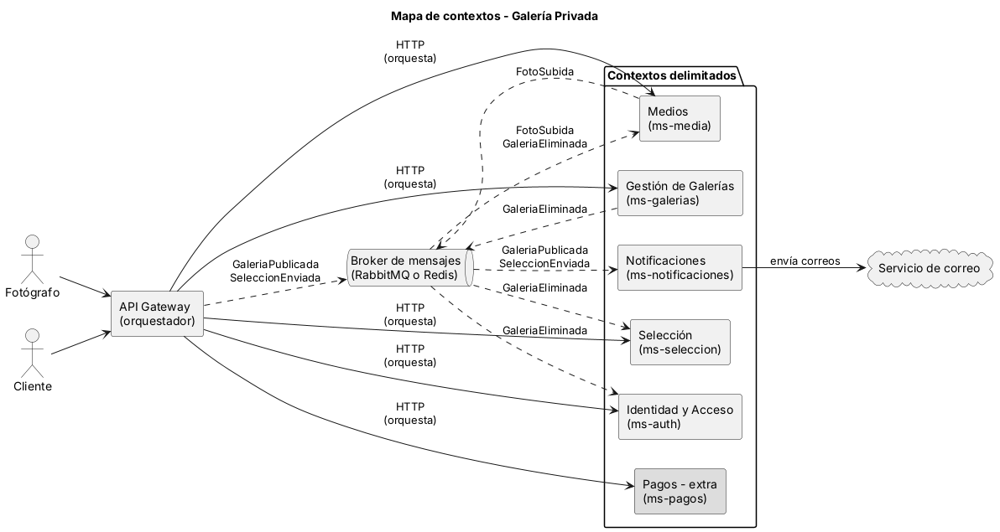

# Paso 4: Bounded contexts

Un **bounded context** es una frontera dentro de la cual cada término tiene un significado único. Se agrupan los agregados que comparten lenguaje y reglas.

## Contextos identificados

| Contexto | Agregados | Responsabilidad | Prioridad |
|---|---|---|---|
| **Identidad y Acceso** | Fotógrafo, Acceso a Galería | Quién es el fotógrafo y cómo entra el cliente a su galería | MVP |
| **Gestión de Galerías** | Galería | Sesiones, datos del cliente, límite y estado | MVP |
| **Medios** | Foto | Subida, miniaturas y entrega protegida de archivos | MVP |
| **Selección** | Selección | Fotos elegidas, comentarios de retoque y envío final | MVP |
| **Notificaciones** | Notificación | Correos y avisos | Después |
| **Pagos** | Pedido | Pedidos y pago simulado de fotos extra | Extra |

## Por qué son contextos separados

Un mismo término significa cosas distintas según el contexto. Es la señal principal de que hay fronteras distintas.

| Término | Gestión de Galerías | Medios | Selección | Notificaciones |
|---|---|---|---|---|
| **Galería** | Sesión con cliente, límite y estado | Solo un identificador al que se asocian archivos | Solo un identificador al que se asocia una selección | Nombre que aparece en el correo |
| **Foto** | No la conoce | Archivo con original, miniatura y estado de procesamiento | Un identificador de foto elegida, con su comentario | No la conoce |
| **Cliente** | Nombre y correo de contacto | No lo conoce | No lo conoce | Destinatario del correo |

## Mapa de contextos

Fuente: [`diagramas/mapa-de-contextos.puml`](diagramas/mapa-de-contextos.puml)

## Relaciones entre contextos

Siguiendo el ADR 0002, los contextos **no se conocen entre sí**: toda colaboración pasa por el API Gateway o por eventos.

| Relación | Mecanismo | Motivo |
|---|---|---|
| Gateway con cada contexto | Llamadas HTTP orquestadas | Operaciones que necesitan datos de varios contextos |
| Gestión de Galerías hacia Medios, Selección e Identidad | Evento `GaleriaEliminada` | Limpieza de datos asociados, sin que Galerías conozca a nadie |
| Medios consigo mismo | Evento `FotoSubida` | Generar miniaturas en segundo plano |
| Gateway hacia Notificaciones | Eventos `GaleriaPublicada` y `SeleccionEnviada` | El correo es secundario y no debe frenar la acción principal |

## Puntos críticos (hotspots)

| ID | Duda | Resolución propuesta |
|---|---|---|
| H-09 | ¿El enlace de acceso pertenece a Identidad o a Galerías? | A **Identidad y Acceso**, como indica la descripción del proyecto ("acceso privado a galerías"). |
| H-10 | ¿Los comentarios de retoque forman un contexto aparte? | No: pertenecen a **Selección**, porque solo tienen sentido sobre una foto marcada y deben quedar consistentes con ella. |
