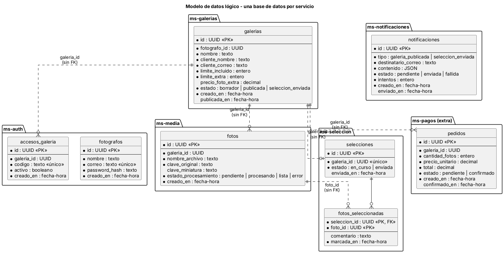

# Paso 6: Modelado de datos

Cada microservicio tiene su **propia base de datos** (RNF-15) y ningún otro servicio accede a ella. Cuando un servicio necesita referirse a algo de otro, guarda solo su identificador (una **referencia lógica**, sin clave foránea).

El modelo es lógico, sin atarse todavía a un motor concreto. El motor se decide en el ADR 0003; mientras tanto el modelo relacional funciona bien para este caso.

> **Nota de implementación.** Cinco servicios materializan su modelo en tablas de PostgreSQL. `ms-pagos` lo materializa como documentos en MongoDB (ADR 0011): el pedido se escribe entero y se lee entero, así que no pierde nada. El modelo lógico de abajo vale para los dos casos; lo que cambia es cómo se guarda.

Fuente: [`diagramas/modelo-de-datos.puml`](diagramas/modelo-de-datos.puml)

## `ms-auth`

**`fotografos`**

| Campo | Tipo | Notas |
|---|---|---|
| id | UUID | Clave primaria |
| nombre | texto | |
| correo | texto | Único |
| password_hash | texto | Nunca texto plano (RNF-03) |
| creado_en | fecha-hora | |

**`accesos_galeria`**

| Campo | Tipo | Notas |
|---|---|---|
| id | UUID | Clave primaria |
| galeria_id | UUID | Referencia lógica a `ms-galerias` |
| codigo | texto | Único, aleatorio y largo (RNF-02) |
| activo | booleano | Permite desactivar el enlace si se regenera o revoca |
| creado_en | fecha-hora | |

## `ms-galerias`

**`galerias`**

| Campo | Tipo | Notas |
|---|---|---|
| id | UUID | Clave primaria |
| fotografo_id | UUID | Referencia lógica a `ms-auth` |
| nombre | texto | |
| cliente_nombre | texto | |
| cliente_correo | texto | |
| limite_incluido | entero | Mayor que cero |
| limite_extra | entero | Por defecto 0; sube al confirmar un pedido extra |
| precio_foto_extra | decimal | Opcional (extra) |
| estado | enumerado | `borrador`, `publicada`, `seleccion_enviada` |
| creado_en | fecha-hora | |
| publicada_en | fecha-hora | Opcional |

Límite vigente = `limite_incluido` + `limite_extra`.

## `ms-media`

**`fotos`**

| Campo | Tipo | Notas |
|---|---|---|
| id | UUID | Clave primaria |
| galeria_id | UUID | Referencia lógica a `ms-galerias` |
| nombre_archivo | texto | |
| clave_original | texto | Ubicación del original en el almacenamiento privado |
| clave_miniatura | texto | Vacío hasta que se genera |
| estado_procesamiento | enumerado | `pendiente`, `procesando`, `lista`, `error` |
| creado_en | fecha-hora | |

Los archivos (originales y miniaturas) no se guardan en la base de datos sino en un almacenamiento de archivos privado; la base solo guarda su ubicación. Qué almacenamiento usar se define en el ADR 0005.

## `ms-seleccion`

**`selecciones`**

| Campo | Tipo | Notas |
|---|---|---|
| id | UUID | Clave primaria |
| galeria_id | UUID | Único; referencia lógica a `ms-galerias` |
| estado | enumerado | `en_curso`, `enviada` |
| enviada_en | fecha-hora | Opcional |

**`fotos_seleccionadas`**

| Campo | Tipo | Notas |
|---|---|---|
| seleccion_id | UUID | Clave primaria compuesta y clave foránea a `selecciones` |
| foto_id | UUID | Clave primaria compuesta; referencia lógica a `ms-media` |
| comentario | texto | Opcional (comentario de retoque) |
| marcada_en | fecha-hora | |

## `ms-notificaciones`

**`notificaciones`**

| Campo | Tipo | Notas |
|---|---|---|
| id | UUID | Clave primaria |
| tipo | enumerado | `galeria_publicada`, `seleccion_enviada` |
| destinatario_correo | texto | |
| contenido | JSON | Datos para armar el correo |
| estado | enumerado | `pendiente`, `enviada`, `fallida` |
| intentos | entero | Para reintentar (HU-17) |
| creado_en | fecha-hora | |
| enviado_en | fecha-hora | Opcional |

## `ms-pagos` (extra)

**`pedidos`**

| Campo | Tipo | Notas |
|---|---|---|
| id | UUID | Clave primaria |
| galeria_id | UUID | Referencia lógica a `ms-galerias` |
| cantidad_fotos | entero | Mayor que cero |
| precio_unitario | decimal | |
| total | decimal | Cantidad por precio unitario |
| estado | enumerado | `pendiente`, `confirmado` |
| creado_en | fecha-hora | |
| confirmado_en | fecha-hora | Opcional |

No existe ningún campo de tarjeta ni de medio de pago (RNF-06).

## Datos duplicados a propósito

| Dato | Dónde se repite | Por qué |
|---|---|---|
| `galeria_id` | Acceso, Fotos, Selección, Pedido | Es la referencia que une los contextos, sin que se llamen entre sí. |
| Datos del correo (destinatario, nombre de la galería, enlace) | `notificaciones.contenido` | El evento los trae completos para que Notificaciones no tenga que consultar a nadie. |

## Puntos críticos (hotspots)

| ID | Duda | Resolución propuesta |
|---|---|---|
| H-12 | ¿Qué motor de base de datos se usa? La descripción del proyecto lo dejó vacío. | Decidir en el ADR 0003. |
| H-13 | ¿Dónde se guardan los archivos? | Decidir en el ADR 0005 (por ejemplo un volumen de Docker o un almacenamiento compatible con S3). |
| H-14 | Sin claves foráneas entre servicios, pueden quedar datos huérfanos. | El evento `GaleriaEliminada` los limpia (ADR 0008). |
